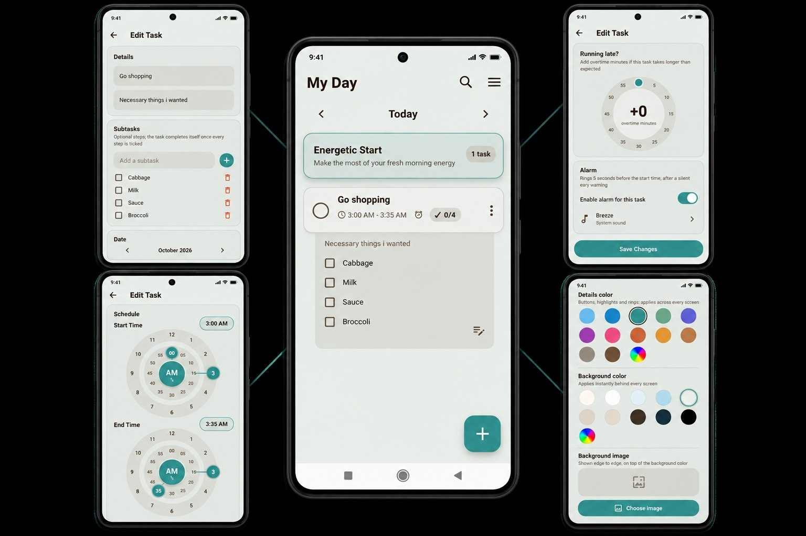

# Arast To Do List

to do app for Android built with Flutter

Arast splits your day into morning noon and night reminds you right before each task starts and shows how your week went

## Screenshots



## Why Arast

* Reliable reminder that rings even when the app is closed, vibration first then sound
* Morning, Noon and Night blocks instead of one endless list
* Smart free slot suggestions based on your own routine
* RGB color wheel and custom background, the whole app rethemes live, background image which makes it better
* Thoughtful extras: weekly insights, 30 day trash, quiet hours, biometric lock and etc

Full list: [docs/FEATURES.md](docs/FEATURES.md)

## Getting started

Requires Flutter 3.5 or newer and an Android device or emulator.

```bash
flutter pub get
flutter run
```

More commands:

```bash
flutter build apk
flutter test
flutter analyze
```

## Project structure

```
lib/        app code: UI, state, database, alarms and settings
packages/   local plugins for exact alarms and vibration
docs/       full feature list and technical review
```

Only the repository layer touches the database, and every save updates the alarm schedule right after, so data and reminders never disagree.

## Tech stack

Flutter, Provider, SQLite, SharedPreferences, table_calendar.

Details on the alarm system and design decisions: [docs/DESIGN_REVIEW.md](docs/DESIGN_REVIEW.md)

## Contributing

Issues and pull requests are welcome. For larger changes please open an issue first.

## License

This project is licensed under the MIT License see the [LICENSE](LICENSE) file for details